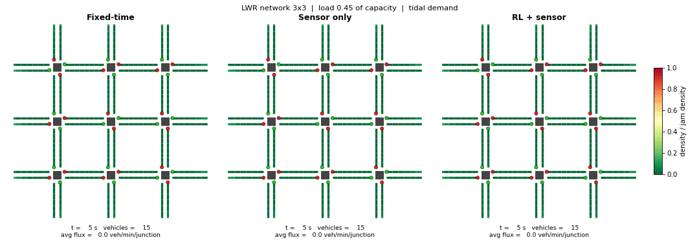

# Traffic flow modelling (LWR) & reinforcement-learning signal control

**Python · NumPy · FastAPI · PDEs**

* Solves the nonlinear **Lighthill–Whitham–Richards** conservation law $\rho_t + q(\rho)_x = 0$ with a
  **conservative Godunov demand–supply finite-volume scheme**.
* Builds signalised **grid networks** (1 junction up to 36) with a FIFO node model that conserves vehicles
  and reproduces queue spillback.
* Trains a **shared-table Q-learning** signal controller on network-wide flux rewards, with a compressed
  96-state space and **sensor-informed priors** to speed up cold start.
* Compares **RL + sensor** vs **sensor only (actuated)** vs **fixed-time** by average flux through the junctions.



*Fixed-time vs sensor-only vs RL + sensor on the same demand. Colour = LWR density, dots = signals.*

| Read this | What it covers |
|---|---|
| [`docs/MATHS.md`](docs/MATHS.md) | all the maths: LWR, shocks, Godunov flux proof, junction model, MDP, metrics |
| [`docs/QLEARNING.md`](docs/QLEARNING.md) | Q-learning explained step by step, with a worked update and what the agent learned |
| [`docs/REPORT.md`](docs/REPORT.md) | the study: three controllers, flux metric, results and limitations |

## Quick start (VS Code)

```bash
git clone https://github.com/deniz-cbn/traffic-lwr-rl.git && cd traffic-lwr-rl
python -m venv .venv && source .venv/bin/activate      # Windows: .venv\Scripts\activate
pip install -r requirements.txt && pip install -e .
pytest                                                  # solver & conservation tests
python experiments/run_experiments.py                   # main study  -> results/   (~6 min)
python experiments/animate.py --show                    # live side-by-side simulation window
python experiments/animate.py                           # or save results/simulation.gif
python experiments/inspect_policy.py                    # what did the Q-table learn?
python experiments/train_agent.py && uvicorn api.main:app --reload   # API docs at /docs
```
In VS Code: *Ctrl+Shift+P* -> **Python: Select Interpreter** -> pick `.venv`, then use the Testing panel for `tests/`.

## Layout
| Path | Contents |
|---|---|
| `src/trafficrl/lwr.py` | fundamental diagram, demand/supply, Godunov step |
| `src/trafficrl/network.py` | grid topology, node (junction) model, signals, sensors |
| `src/trafficrl/controllers.py` | fixed-time and classic actuated (sensor) controllers |
| `src/trafficrl/qlearning.py` | shared-table Q-learning agent + sensor prior |
| `src/trafficrl/sim.py` | demand generator (tidal flows), episode runner, metrics |
| `experiments/run_experiments.py` | main study (fixed vs sensor vs RL + sensor) |
| `experiments/animate.py` | simulation visualisation (window or GIF) |
| `experiments/inspect_policy.py` | compare learned policy with the sensor rule |
| `experiments/ablations.py` | optional extras: pure RL (no prior), transfer 2x2 -> larger grids |
| `tests/` | Riemann-flux equivalence, Rankine–Hugoniot shock speed, mass conservation, bounds |
| `api/main.py` | FastAPI `/simulate` endpoint |

## Headline results (see the report for caveats)
* **Flux through junctions:** RL + sensor matches sensor-only at light load, and is ahead at medium and heavy
  load on larger grids (up to +2.9% on 6x6, consistent over seeds at medium load). At saturation there is no reliable
  difference. The gaps are small because junction flux is capped by demand and capacity.
* **Delay (total time spent, cross-check):** RL + sensor cuts it by 7–19% at medium load and 10–17% at heavy load
  on grids of 2x2 and up. Fixed-time is 3–28% worse than sensor-only at light and medium load.
* Learning is fast: one training episode on 3x3 already captures most of the flux gain.
* Caveats: 3 training seeds, untuned baseline, flux is also the RL training reward. Details in the report.
