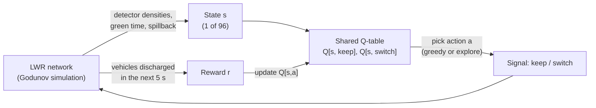

# Q-learning in this project, explained

This document explains *how the traffic light learns*, from the intuition up to the exact update rule,
using numbers taken from a real trained table. (For the formal treatment — Bellman equation,
convergence conditions, caveats — see `MATHS.md` §7–8.)

---

## 1. The idea in plain words

A traffic light has to decide, every few seconds: **keep this green, or switch?**
Nobody tells it the right answer. Instead it:

1. tries something,
2. sees how many vehicles got through the junction afterwards (its **reward**),
3. remembers "in *this kind of situation*, *this choice* led to *this much* good outcome",
4. repeats this thousands of times, and gradually prefers the choices that worked.

That memory is the **Q-table**. *Q* stands for "quality": `Q(situation, action)` is a number estimating
**how much total flux the junction can expect from now on if it takes this action in this situation and then
keeps behaving well.**

---

## 2. The learning loop



Every **5 seconds of simulated time**, each intersection runs one turn of this loop. In a 3x3 grid that is
9 agents x 360 decisions = 3240 learning samples per 30-minute episode, all feeding the **same** table.

---

## 3. The four ingredients (and where they live in the code)

| Ingredient | In this project | Code |
|---|---|---|
| **Agent** | each signalised intersection (all share one brain) | `SharedQAgent` in `qlearning.py` |
| **State** `s` | a compressed local summary of what the detectors see (below) | `SharedQAgent.encode` |
| **Action** `a` | `0 = keep` the current phase, `1 = switch` (costs 2 s all-red) | `decide` |
| **Reward** `r` | vehicles discharged through the intersection in the last 5 s, normalised to [0,1], blended with the network average | `decide`, `net.pop_flux()` |

### The state: 96 situations
Raw sensor readings are continuous, so there'd be infinitely many situations. We **compress** them into a
few buckets so the table is small enough to learn quickly:

| Feature | Buckets | Meaning |
|---|---|---|
| green-side density `g` | empty / light / queue / jam | busiest approach currently **green** |
| red-side density `r` | empty / light / queue / jam | busiest approach currently **red** |
| green time | <20 s / 20–40 s / ≥40 s | how long this phase has been running |
| spillback flag | no / yes | is any outbound link nearly full? (switching would feed a blocked road) |

4 x 4 x 3 x 2 = **96 states**, x 2 actions = **192 numbers** in the whole table.
Describing things as "green side / red side" rather than "east-west / north-south" means the table doesn't
care which axis is currently green, which halves its size and lets one table serve every junction.

### The reward
For one 5 s interval, let `phi_k` be the number of vehicles that crossed intersection *k*, divided by the
most that could cross (2 x capacity x 5 s), so `phi_k` is in [0,1]. Each agent is rewarded with

```
r_k = 0.5 * (average phi over ALL intersections) + 0.5 * phi_k
```

The network-wide half teaches cooperation (don't dump a queue on your neighbour); the local half keeps
the signal clean enough to learn from (your own action matters more to your own flux).
Why flux, not delay? Because total time spent equals the area between cumulative arrivals and cumulative
exits (MATHS §6), so keeping vehicles moving out of the system is what reduces delay — and flux is
available instantly at every step, whereas delay is only known after vehicles finish their trips.

---

## 4. Reading the Q-table

Each row is a situation, each column an action. From a real table (trained 40 episodes on a 2x2 grid):

| green side | red side | green time | spillback | Q(keep) | Q(switch) |
|---|---|---|---|---|---|
| light (0.12–0.25) | jam (>0.45) | 20–40 s | no | 7.56 | **8.24** |

Reading it: "The green approaches are lightly used, the red approaches are jammed, we've had green for a
while, nothing downstream is blocked." Keeping green is expected to yield 7.56 units of future reward,
switching 8.24, so the agent switches.

**Why are the numbers around 8?** The reward per 5 s is roughly 0.8 at heavy load, and future rewards are
discounted by `gamma = 0.9` per step, so the sum is about `0.8 / (1 - 0.9) = 8`. The numbers only mean something
*relative to each other within a row*: the difference 8.24 − 7.56 is the benefit of switching here.

---

## 5. The learning rule, step by step

After the agent takes action `a` in state `s`, waits 5 s, collects reward `r`, and lands in state `s'`:

```
target   = r + gamma * max over a' of Q[s', a']        # "what I got" + "the best I think I can get from here"
error    = target - Q[s, a]                            # was I too optimistic or too pessimistic?
Q[s, a] <- Q[s, a] + alpha * error                     # nudge the estimate towards the target
```

### A worked example (real Q-value, hypothetical outcome)
Take the row above and say the agent switched (`a = switch`, current `Q = 8.24`). Suppose that over the next
5 s the network pushed through lots of vehicles: `r = 0.90`. The new situation `s'` has best action value
`max Q[s', .] = 8.0`. With `alpha = 0.1` and `gamma = 0.9`:

| step | calculation | result |
|---|---|---|
| target | 0.90 + 0.9 x 8.0 | **8.10** |
| error | 8.10 − 8.24 | −0.14 |
| update | 8.24 + 0.1 x (−0.14) | **8.226** |

Slightly lower: the outcome was a bit worse than the table expected, so the estimate is nudged down.
One nudge is tiny on purpose: `alpha = 0.1` means every experience moves the estimate 10% of the way,
so the table averages over thousands of noisy samples rather than over-reacting to any single
5-second window (traffic is random!).

### What the two knobs mean
* **alpha (learning rate, 0.1):** how far to move per experience. Too large -> twitchy; too small -> slow.
* **gamma (discount, 0.9):** how much the future counts. `1/(1-gamma) = 10` steps = about **50 s of look-ahead**,
  enough to see that "switching now costs 2 s of lost time but lets a jammed side discharge".

The key trick is **bootstrapping**: `max Q[s', .]` is itself an estimate learned from experience, so good
news about the future propagates backwards through the table, one update at a time, until the values for
early decisions reflect their long-term consequences.

---

## 6. Exploration vs exploitation

If the agent always picked the best-looking action, it would never discover that an apparently worse one is
actually better. So during **training** it uses **epsilon-greedy**:

* with probability `1 − eps` -> exploit: pick `argmax Q[s, .]`
* with probability `eps` -> explore: try something else

`eps` starts at 0.30 and decays by 3% per episode to a floor of 0.02, so the agent experiments a lot early,
and mostly exploits later. At **evaluation** time `eps = 0` and no learning happens: it's a fixed policy.

### Guided exploration (our twist)
Plain exploration picks randomly, which at a real junction means mistimed switches. We instead explore by
following the **sensor rule** 70% of the time (and random 30% of the exploration steps). Q-learning is
*off-policy*: it learns the value of the *best* policy regardless of how experiences were gathered, so
guiding exploration changes what data we collect, not what the table converges to.

---

## 7. One table, many junctions

All intersections read from and write to **one** Q-table. Benefits:

* **9x (or 36x) more data per episode** on larger grids — the table fills in quickly.
* **Transfer:** the state is local and phase-relative, so a table trained on 2x2 can run a 6x6 grid unchanged.
* The cost is that every junction is forced to share one behaviour (a junction on the edge of the city gets the
  same policy as one in the middle), and each agent is learning while its neighbours also change, so the
  environment is *non-stationary* — which is why we evaluate empirically instead of relying on convergence theorems.

---

## 8. The sensor prior and the safety layer

**Prior.** A fresh table would know nothing and behave randomly. Instead, every entry starts at `6.0`
(on the scale of the typical Q-values), and the action the classic **actuated rule** would take gets a
`+0.3` bonus. Greedy-on-this-table therefore *is* the sensor controller at the start — the RL agent begins as
the incumbent and learns improvements instead of learning to be sensible from scratch.

**Initial value matters.** We found this experimentally: starting at 2.0 (far below the true scale of 4–9)
made the first action tried look better than every untried one, so exploration froze and performance
swung wildly early in training (up to 29% worse than actuated). Starting on the right scale (6.0) was stable.

**Safety layer.** Before the table is consulted, hard rules from the sensor controller apply: never switch
before 10 s of green; always switch after 45 s if a vehicle is waiting on red. The agent only decides in the
band in between. These forced steps are not used for learning (the agent didn't choose them).

---

## 9. What did it actually learn?

`python experiments/inspect_policy.py` compares the trained table with the sensor rule it started from.
In a 40-episode run on 2x2, only **32 of the 96 states** were ever visited (many combinations, like "everything
jammed and green for under 20 s", are rare), and the agent **disagreed with the sensor rule in 6 of them**:

| green side | red side | green time | Q(keep) | Q(switch) | sensor rule | RL choice |
|---|---|---|---|---|---|---|
| jam | jam | <20 s (spillback) | 7.63 | 8.52 | keep | **switch** |
| light | jam | <20 s | 7.32 | 8.18 | keep | **switch** |
| light | jam | 20–40 s | 7.56 | 8.24 | keep | **switch** |
| queue | jam | <20 s | 7.78 | 8.32 | keep | **switch** |
| jam | jam | ≥40 s | 9.28 | 8.96 | switch | **keep** |

The pattern is interpretable: **when the red side is jammed, RL switches sooner than the sensor rule**, even while the
green side still has a few vehicles. The sensor rule only switches once the green approach has "gapped out"
(emptied), so a jammed side can wait a long time behind a trickle of vehicles. RL has learned a
queue-balancing behaviour: don't hold green for a light flow while a jam builds elsewhere. Conversely, when both sides are jammed and green has run ≥40 s, it
*keeps* green rather than wasting 2 s on a switch that can't clear both queues. This is the sort of
adaptive behaviour that simple threshold logic can't express — and it's a hypothesis for *why* RL beat the sensor
controller in the results, not a proof.

---

## 10. Pseudocode of the whole training procedure

```python
Q = initial_table(prior=sensor_rule)                      # 96 x 2, every entry ~6, +0.3 on sensor action
for episode in range(50):
    sample random load and tidal pattern; reset the network
    for every 5 s control step:
        s_new = encode(detectors, green_time, spillback)  # one state per intersection
        r     = 0.5 * mean_flux + 0.5 * own_flux          # from the last 5 s
        for each intersection i that made a free choice last step:
            Q[s[i], a[i]] += alpha * (r[i] + gamma * max(Q[s_new[i]]) - Q[s[i], a[i]])
        for each intersection i:
            apply safety rules (min / max green)
            otherwise choose a[i]: epsilon-greedy (exploration guided by the sensor rule)
        send actions to the LWR network and advance 5 s (5 Godunov steps of 1 s)
    decay epsilon
```

---

## 11. Why tabular Q-learning (and not deep RL)?

* **Interpretable:** you can print the whole policy (section 9) and say *why* it does what it does.
* **Fast and light:** 50 episodes train in seconds on a laptop; no GPU.
* **Limits:** 96 coarse states can't see neighbouring junctions (no green waves) or fine-grained queue lengths.
  A natural upgrade is neighbour-pressure features or a neural network (DQN) as the Q-function.

## 12. Quick glossary

| Term | Meaning |
|---|---|
| Episode | one simulated 30-minute run |
| Policy | the rule "in state s, do action a" (here: argmax of the Q-table row) |
| Greedy | pick the action with the highest Q |
| Off-policy | learning about the best policy while behaving differently (exploring) |
| Bootstrapping | updating an estimate using another estimate (`max Q[s', .]`) |
| Parameter sharing | many agents using and updating one table |
