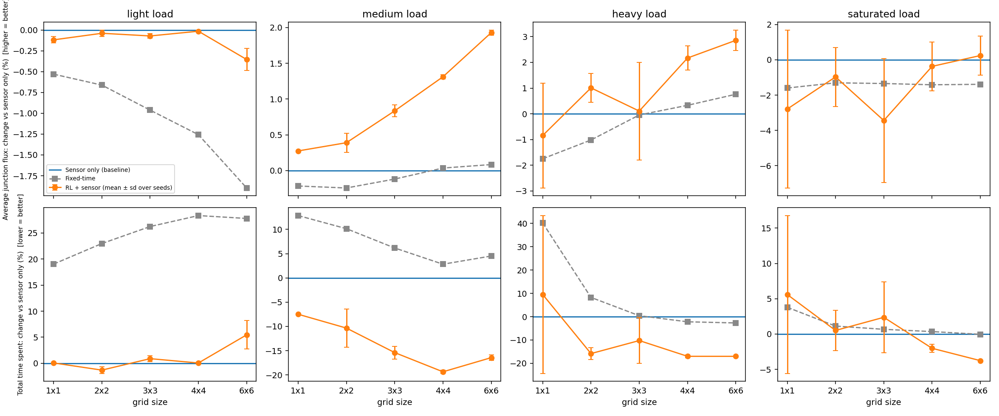
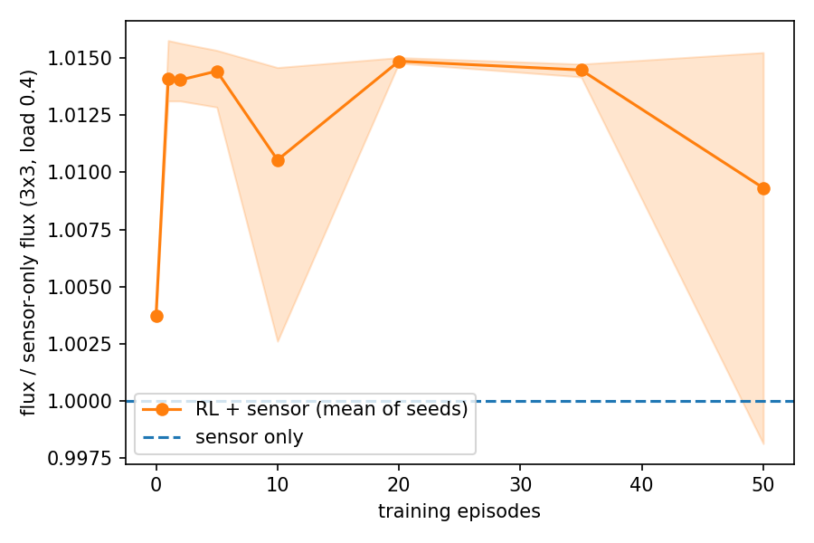

# Report: RL + sensor vs sensor-only vs fixed-time, measured by junction flux

*Numbers come from `experiments/run_experiments.py` (`results/results.json`, `results/results.md`).
Derivations are in [`MATHS.md`](MATHS.md); the learning algorithm is explained in [`QLEARNING.md`](QLEARNING.md).*

## 1. Question
Does a Q-learning signal controller that sits on top of classic detector logic push **more vehicles through the
junctions** than the detector logic alone, and than fixed-time signals, as the network grows from one junction to a
36-junction grid and as demand rises toward capacity?

**Metric (primary): average flux through the junctions**, in vehicles per minute per junction, averaged over a
30-minute run:
$$\bar\Phi=\frac{1}{K\,(T/60)}\sum_{t}\sum_{k=1}^{K} f_k(t)\,\Delta t ,$$
where $f_k$ is the flow discharged through intersection $k$ (the same quantity the agent is rewarded with).
Higher is better. **Cross-check (secondary): total time spent (TTS)**, which measures delay (MATHS §6).

### Why flux needs care as a headline metric
1. **It is the training reward**, so RL is judged on what it optimises. The baselines are not optimising it.
2. **It is bounded by demand and capacity.** If no queue builds up, every junction passes exactly what arrives,
   whichever controller runs (conservation). A junction can pass at most about $2q_{\max}=67.5$ veh/min (one axis
   at a time), less lost time; we measure about 62 when saturated. So controllers can differ only through how many
   vehicles are *stored* in queues and how well capacity is used when saturated, and the gaps are small by construction.
3. **It does not see delay.** Two controllers can pass the same flux while one makes vehicles wait far longer. TTS captures that.

So we report flux as the headline, as requested, and put the TTS cross-check beside it.

## 2. Setup
* **Simulator:** Godunov demand–supply LWR on every link (25 m cells, 200 m links, $\Delta t=1$ s, CFL 0.6), FIFO
  node model, 2 s all-red lost time. Square grids 1x1, 2x2, 3x3, 4x4, 6x6 (1 to 36 junctions); turning split 70/15/15.
* **Demand:** per-entry rate = load x link capacity, with a tidal E/W vs N/S swing of ±30% over the run.
  Loads: light 0.25, medium 0.35, heavy 0.45, saturated 0.65 (of link capacity).
* **Controllers** (all decide every 5 s):
  * *Fixed-time:* 30 s greens.
  * *Sensor only:* vehicle-actuated logic (min green 10 s, max 45 s, gap-out below 0.12 of jam density, call at 0.12).
  * *RL + sensor:* shared 96-state Q-table, initialised from the sensor rule, with guided exploration and the
    sensor's min/max-green safety layer (QLEARNING §8).
* **Training:** 50 episodes per grid size, random load in [0.2, 0.75] and tilt in [0, 0.5], 3 independent training seeds.
* **Evaluation:** greedy policy, 6 held-out demand seeds per load, identical demand for all controllers.

## 3. Results

### Average flux through junctions [veh/min per junction] — higher is better
"RL vs sensor" is the mean ± standard deviation over the 3 training seeds; "seeds better" counts seeds
whose flux beat sensor-only.

| Grid | Load | Fixed-time | Sensor only | RL + sensor | RL vs sensor | seeds better |
|---|---|---|---|---|---|---|
| 1x1 | light | 32.36 | 32.53 | 32.49 | -0.1% ± 0.0 | 0/3 |
| 1x1 | medium | 45.23 | 45.33 | 45.45 | +0.3% ± 0.0 | 3/3 |
| 1x1 | heavy | 56.49 | 57.50 | 57.01 | -0.8% ± 2.0 | 2/3 |
| 1x1 | saturated | 62.49 | 63.50 | 61.73 | -2.8% ± 4.5 | 2/3 |
| 2x2 | light | 32.46 | 32.67 | 32.66 | -0.0% ± 0.0 | 1/3 |
| 2x2 | medium | 45.30 | 45.41 | 45.59 | +0.4% ± 0.1 | 3/3 |
| 2x2 | heavy | 56.10 | 56.68 | 57.25 | +1.0% ± 0.6 | 3/3 |
| 2x2 | saturated | 61.77 | 62.59 | 61.98 | -1.0% ± 1.7 | 1/3 |
| 3x3 | light | 32.00 | 32.31 | 32.29 | -0.1% ± 0.0 | 0/3 |
| 3x3 | medium | 44.63 | 44.69 | 45.06 | +0.8% ± 0.1 | 3/3 |
| 3x3 | heavy | 55.31 | 55.33 | 55.39 | +0.1% ± 1.9 | 2/3 |
| 3x3 | saturated | 60.84 | 61.67 | 59.55 | -3.4% ± 3.5 | 1/3 |
| 4x4 | light | 32.00 | 32.40 | 32.40 | -0.0% ± 0.0 | 1/3 |
| 4x4 | medium | 44.58 | 44.56 | 45.15 | +1.3% ± 0.0 | 3/3 |
| 4x4 | heavy | 54.85 | 54.67 | 55.86 | +2.2% ± 0.5 | 3/3 |
| 4x4 | saturated | 59.97 | 60.83 | 60.60 | -0.4% ± 1.4 | 2/3 |
| 6x6 | light | 31.04 | 31.64 | 31.53 | -0.4% ± 0.1 | 0/3 |
| 6x6 | medium | 43.15 | 43.11 | 43.94 | +1.9% ± 0.0 | 3/3 |
| 6x6 | heavy | 52.93 | 52.54 | 54.04 | +2.9% ± 0.4 | 3/3 |
| 6x6 | saturated | 57.93 | 58.75 | 58.89 | +0.2% ± 1.1 | 2/3 |



*Top row: flux change vs sensor-only (higher is better). Bottom row: TTS change (lower is better).*

### Cross-check: total time spent, change vs sensor only — lower is better

| Grid | Load | Fixed-time vs sensor | RL + sensor vs sensor |
|---|---|---|---|
| 1x1 | light | +19.0% | +0.1% ± 0.0 |
| 1x1 | medium | +12.8% | -7.5% ± 0.0 |
| 1x1 | heavy | +40.2% | +9.5% ± 33.9 |
| 1x1 | saturated | +3.8% | +5.6% ± 11.2 |
| 2x2 | light | +23.0% | -1.3% ± 0.6 |
| 2x2 | medium | +10.1% | -10.3% ± 4.0 |
| 2x2 | heavy | +8.3% | -15.8% ± 2.5 |
| 2x2 | saturated | +1.1% | +0.5% ± 2.8 |
| 3x3 | light | +26.2% | +0.9% ± 0.5 |
| 3x3 | medium | +6.2% | -15.4% ± 1.3 |
| 3x3 | heavy | +0.4% | -10.2% ± 9.8 |
| 3x3 | saturated | +0.7% | +2.4% ± 5.0 |
| 4x4 | light | +28.3% | +0.1% ± 0.2 |
| 4x4 | medium | +2.8% | -19.4% ± 0.3 |
| 4x4 | heavy | -2.2% | -17.0% ± 0.7 |
| 4x4 | saturated | +0.3% | -2.0% ± 0.6 |
| 6x6 | light | +27.8% | +5.5% ± 2.7 |
| 6x6 | medium | +4.5% | -16.4% ± 0.5 |
| 6x6 | heavy | -2.7% | -17.0% ± 0.2 |
| 6x6 | saturated | -0.0% | -3.8% ± 0.0 |

### Learning curve (3x3, load 0.4)


RL + sensor flux relative to sensor-only: 1.004 at episode 0 (the prior reproduces the sensor rule),
**1.014 after a single training episode**, and about 1.014 thereafter. One of the three seeds fell to 0.998
at episode 50, a reminder that a constant-step-size learner with residual exploration is noisy.

## 4. Findings

1. **On flux the three controllers are close, and RL + sensor is never clearly worse except at saturation.**
   * *Light load:* all three match to within 0.5% (RL), while fixed-time is up to 1.9% lower on big grids.
   * *Medium load:* RL + sensor is higher than sensor-only in all 3 seeds on every grid, and the gain grows with
     network size, from +0.3% (1x1) to +1.9% (6x6).
   * *Heavy load:* RL gains +1.0% (2x2), +2.2% (4x4) and +2.9% (6x6) over sensor-only (about +1.5 veh/min per junction
     on 6x6). The 1x1 and 3x3 results are not reliable: they have a seed-to-seed spread of 2 percentage points.
   * *Saturated:* no reliable difference. Flux is capacity-limited, differences are within noise (−3.4% to +0.2%),
     and all controllers sit near the ceiling.
2. **The flux gains are small in absolute terms (at most about 3%)**, which is expected from the bound in §1. They are
   nonetheless consistent at medium load and on large grids at heavy load.
3. **The delay gains are much larger.** TTS falls 7–19% at medium load and 10–17% at heavy load on grids of 2x2 and up,
   while fixed-time is 3–28% worse than sensor-only at light and medium load. Flux alone understates what the controllers do differently. Exceptions: at light load RL is not better (+5.5% TTS on 6x6, i.e. slightly worse), and the 1x1 heavy case has one badly performing seed (TTS +9.5% ± 34).
4. **Fixed-time is not far behind in flux, but it is far behind in delay.** At light load fixed-time carries
   up to 1.9% less flux and 19–28% more total time spent. At heavy load on large grids the sensor logic and fixed-time
   converge (within ±3%), so the detector logic has little advantage once the network is crowded.
5. **Learning is fast.** The shared table gets one sample per junction per 5 s, so a 9-junction grid produces
   3240 samples per episode and one episode already captures most of the gain.

## 5. Limitations (read before quoting numbers)
1. **Small sample:** 3 training seeds and 6 evaluation demand seeds. Differences of about 1% are only meaningful where
   all seeds agree (e.g. medium load).
2. **Training-distribution sensitivity.** In an earlier version of this study (training loads in [0.2, 0.5], archived in
   `results/ablations/`) the 1x1 heavy case was −14% TTS with tiny spread; after widening the range to [0.2, 0.75]
   (to cover the saturated level) it became unstable, with one seed far worse. Results depend on the training demand
   distribution and on seeds.
3. **Untuned baseline.** The actuated thresholds were set a priori. A tuned controller, or max-pressure, may
   close part of the gap.
4. **Metric circularity.** RL is trained on flux, so flux favours it by design. TTS is not the training objective, which is
   why we report it too.
5. **Hyper-parameters** ($Q_0=6$, $\alpha=0.1$) were chosen with a small sweep on 2x2 using demand seeds that overlap the
   evaluation seeds, so 2x2 may be slightly optimistic.
6. **Model scope:** LWR with Greenshields diagram (no capacity drop, no inertia), fixed turning ratios,
   single-lane-equivalent links, one demand family.

## 6. Reproduce
```bash
python experiments/run_experiments.py --episodes 50 --train-seeds 3 --eval-seeds 6   # about 6 min
python experiments/make_figures.py                                                    # rebuild figures
python experiments/animate.py                                                         # side-by-side simulation GIF
python experiments/ablations.py                                                       # optional: pure RL and transfer
```

## 7. Next steps
Tune the baseline and add max-pressure; more seeds with confidence intervals; ablate the spillback flag and the reward
mix; train on the target load range per grid; add neighbour information to the state to learn green waves.
