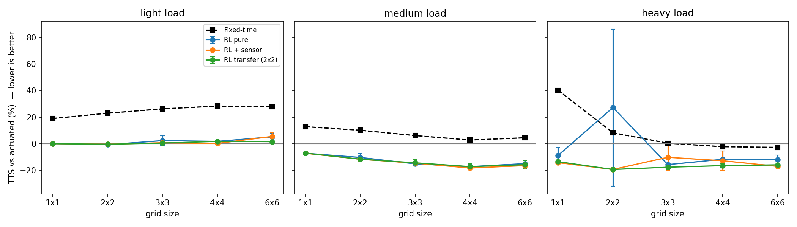
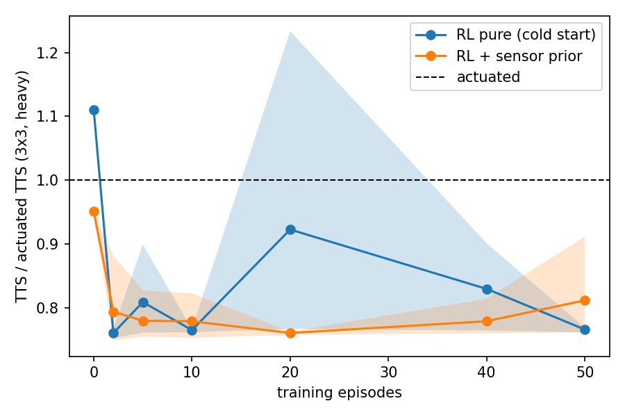

# Report: Does RL + sensor logic beat sensor logic alone as networks get more complex?

*All numbers below are produced by `experiments/run_experiments.py` (`results/results.json`,
`results/results.md`). Mathematical derivations are in [`MATHS.md`](MATHS.md).*

## 1. Question and hypotheses
Classic **vehicle-actuated** control uses stop-line detectors only. We ask whether a shared-table
Q-learning controller, seeded with the actuated logic as a prior and sharing its min/max-green safety
layer, reduces **total time spent (TTS)** on LWR networks of growing size and load.

* **H1.** RL + sensor reduces TTS versus actuated, with the benefit growing with network
  complexity and congestion (spillback and coordination matter more).
* **H2.** The sensor-informed prior improves cold-start behaviour/robustness versus pure RL.
* **H3.** A table trained on a 2x2 grid transfers to larger grids without retraining.

## 2. Methods (summary)
* **Simulator:** Godunov demand–supply LWR on every link (25 m cells, 8 cells/link = 200 m, $\Delta t=1$ s,
  CFL = 0.6), FIFO node model with proportional supply sharing, 2 s all-red lost time (MATHS §1–5).
* **Networks:** square grids 1x1, 2x2, 3x3, 4x4, 6x6 (1 → 36 intersections); every intersection has 4
  approaches, turning split 70/15/15 (through/left/right).
* **Demand:** per-entry-link rate $=\text{load}\cdot q_{\max}\cdot$noise, with a *tidal* E/W vs N/S
  swing of $\pm30\%$ over the 30-min run. Loads: light 0.25, medium 0.35, heavy 0.45 of capacity.
* **Controllers** (all decide every 5 s): fixed-time (30 s greens); **actuated** (min green 10 s,
  max 45 s, gap-out at ρ/ρmax<0.12, call at ≥0.12); **RL pure** (flat Q-table); **RL + sensor**
  (prior + guided exploration, MATHS §8); **RL transfer** (RL + sensor trained on 2x2 only, then frozen).
* **Training:** 50 episodes of 1800 s per agent, random load ∈[0.2,0.5], tilt ∈[0,0.5]; 3 independent training
  seeds; ε-greedy with ε₀=0.3 decaying ×0.97/episode, α=0.1, γ=0.9, μ=0.5, $Q_0$=6.
* **Evaluation:** greedy policy, 6 held-out demand seeds × 3 loads, identical demand for every controller.
  Metric: % change in mean TTS versus actuated.

## 3. Solver validation
Seven automated tests (`tests/test_lwr.py`) pass:
Godunov flux equals the exact Riemann flux on 2000 random pairs; numerical shock position matches the
Rankine–Hugoniot speed to within 3 cells; densities stay in $[0,\rho_{\max}]$ through a rarefaction;
network mass balance (on-link vehicles = entered − exited) holds to $10^{-6}$ veh through 3x3 junction dynamics.

## 4. Results



TTS change vs actuated (negative = better); RL cells are mean ± std over 3 training seeds, then
(seeds beating actuated / 3):

| Grid | Load | Actuated TTS (veh·s) | Fixed-time | RL pure | RL + sensor | RL transfer (2x2→) |
|---|---|---|---|---|---|---|
| 1x1 | light | 34877 | +19.0% | +0.1% ± 0.0 (0/3) | +0.1% ± 0.0 (0/3) | +0.1% ± 0.0 (0/3) |
| 1x1 | medium | 56325 | +12.8% | -7.2% ± 0.0 (3/3) | -7.1% ± 0.0 (3/3) | -7.0% ± 0.4 (3/3) |
| 1x1 | heavy | 102524 | +40.2% | -8.8% ± 5.8 (3/3) | -14.2% ± 0.3 (3/3) | -13.5% ± 1.1 (3/3) |
| 2x2 | light | 112031 | +23.0% | -0.7% ± 0.4 (3/3) | -0.4% ± 0.5 (2/3) | -0.4% ± 0.5 (2/3) |
| 2x2 | medium | 191819 | +10.1% | -10.3% ± 2.7 (3/3) | -11.6% ± 1.4 (3/3) | -11.6% ± 1.4 (3/3) |
| 2x2 | heavy | 390272 | +8.3% | +27.2% ± 59.0 (2/3) | -19.3% ± 1.3 (3/3) | -19.3% ± 1.3 (3/3) |
| 3x3 | light | 224236 | +26.2% | +2.4% ± 3.6 (1/3) | +0.8% ± 0.6 (1/3) | +0.5% ± 0.9 (1/3) |
| 3x3 | medium | 407201 | +6.2% | -15.1% ± 0.6 (3/3) | -14.6% ± 1.5 (3/3) | -14.3% ± 2.3 (3/3) |
| 3x3 | heavy | 779413 | +0.4% | -15.7% ± 0.1 (3/3) | -10.2% ± 10.1 (2/3) | -17.6% ± 1.7 (3/3) |
| 4x4 | light | 378547 | +28.3% | +1.8% ± 0.4 (0/3) | +0.2% ± 0.7 (2/3) | +1.8% ± 0.5 (0/3) |
| 4x4 | medium | 720514 | +2.8% | -17.2% ± 1.6 (3/3) | -18.2% ± 1.0 (3/3) | -17.2% ± 2.5 (3/3) |
| 4x4 | heavy | 1317174 | -2.2% | -11.7% ± 6.3 (3/3) | -12.7% ± 7.2 (3/3) | -16.4% ± 1.7 (3/3) |
| 6x6 | light | 789614 | +27.8% | +5.2% ± 2.7 (0/3) | +5.5% ± 2.8 (0/3) | +1.5% ± 0.5 (0/3) |
| 6x6 | medium | 1471591 | +4.5% | -14.9% ± 0.5 (3/3) | -16.4% ± 0.5 (3/3) | -15.7% ± 2.8 (3/3) |
| 6x6 | heavy | 2547775 | -2.7% | -11.9% ± 3.3 (3/3) | -17.0% ± 0.1 (3/3) | -15.9% ± 2.2 (3/3) |

### Learning curves (3x3, load 0.4, TTS / actuated TTS, 3 training seeds)


| episodes | 0 | 2 | 5 | 10 | 20 | 40 | 50 |
|---|---|---|---|---|---|---|---|
| RL pure (mean) | 1.11 | 0.76 | 0.81 | 0.76 | 0.92 | 0.83 | 0.77 |
| RL + sensor (mean) | 0.95 | 0.79 | 0.78 | 0.78 | 0.76 | 0.78 | 0.81 |

## 5. Findings

**H1 — supported for medium and heavy load, not for light load.**
* *Light load:* RL gives no benefit (−0.7% to +5.5%); it is slightly *worse* on the 6x6 grid. When the
  network is far from capacity, the actuated rule is already near-optimal and there is little to gain.
* *Medium load:* RL beats actuated in all 3/3 training seeds on every grid, from −7% (1x1) to −15…−18%
  (≥3x3), with small seed-to-seed spread. The gain grows from the single junction to multi-junction grids
  and then plateaus.
* *Heavy load:* RL + sensor is 10–19% better, and the actuated advantage over fixed-time disappears on
  large saturated grids (fixed-time is within ±3% of actuated on 3x3–6x6). Our *hypothesis* (not tested here) is that RL
  helps because its state includes a downstream-spillback flag that the detector logic ignores;
  an ablation removing that flag would test it.

**H2 — partially supported.**
* *Cold start:* at episode 0 the prior-initialised agent is 5% better than actuated, whereas the pure agent
  is 11% worse (1.11) — the prior really does give a safe starting policy.
* *Convergence speed:* the benefit is small: both agents reach ≈0.76–0.78 of actuated within ~2 episodes
  (the shared table gets 9 agents' samples per episode), so the prior does not noticeably speed up
  asymptotic learning at this scale.
* *Reliability:* pure RL showed one catastrophic seed (2x2 heavy: +27% ± 59%) and transient
  collapses mid-training (1.23 at episode 20); the prior version had none on 2x2 but had its own
  weaker seeds (3x3 heavy ±10.1; one 0.91 reading at episode 50). With only 3 seeds we cannot claim
  the prior is significantly more stable; the evidence is suggestive, not conclusive. A common cause of
  the dips is that we evaluate snapshots of a still-exploring constant-α learner.

**H3 — supported.** The table trained on 2x2 and frozen performs comparably to tables trained
in place: e.g. 4x4 heavy −16.4% vs −12.7%/−11.7%, 6x6 medium −15.7% vs −16.4%/−14.9%, 6x6 heavy −15.9% vs
−17.0%/−11.9%. Because the state is local and phase-relative, one small-grid training run suffices.

## 6. Threats to validity (please read before quoting numbers)
1. **Small sample:** 3 training seeds, 6 evaluation demand seeds per load. Differences of a few % are not
   significant; only the consistent medium-load effect (3/3 seeds, small std) is robust.
2. **Baseline not tuned.** Actuated thresholds (call/gap 0.12, 10–45 s) were set a priori, not optimised.
   A tuned actuated controller or **max-pressure** control may narrow the gap. Next step: grid-search the
   baseline on the same seeds, and add max-pressure.
3. **Hyper-parameter selection overlapped the evaluation setting:** the choice $Q_0=6$ and α=0.1 was made
   by a small sweep on 2x2 at loads 0.35/0.45 using the *same* demand seeds (100–103) later used in
   evaluation. 2x2 results may be slightly optimistic. (The sweep showed $Q_0=2$ was unstable: TTS up to
   1.29× actuated at episode 10; $Q_0\ge6$ stable.)
4. **In-distribution test:** evaluation demand uses the same generator family as training (new seeds,
   fixed tilt 0.3); real traffic is more varied. All results are inside one LWR model (no capacity drop,
   fixed turning ratios, single-lane-equivalent links).
5. **Reward alignment:** the flux reward is a proxy for TTS (MATHS §6); the table reports TTS directly, but
   we did not report throughput/variance of delay across vehicles (fairness).

## 7. Reproduce
```bash
python experiments/run_experiments.py --episodes 50 --train-seeds 3 --eval-seeds 6 --sizes 1 2 3 4 6
```
Run time ≈ 12 min on a laptop CPU.

## 8. Suggested next steps
Ablations (no blocked flag, μ∈{0,0.5,1}, no safety layer); max-pressure and tuned-actuated baselines;
more seeds with confidence intervals; non-grid topologies (arterials, irregular networks); a different
fundamental diagram (triangular, with capacity drop); neighbour-aware states or DQN to learn green waves.
